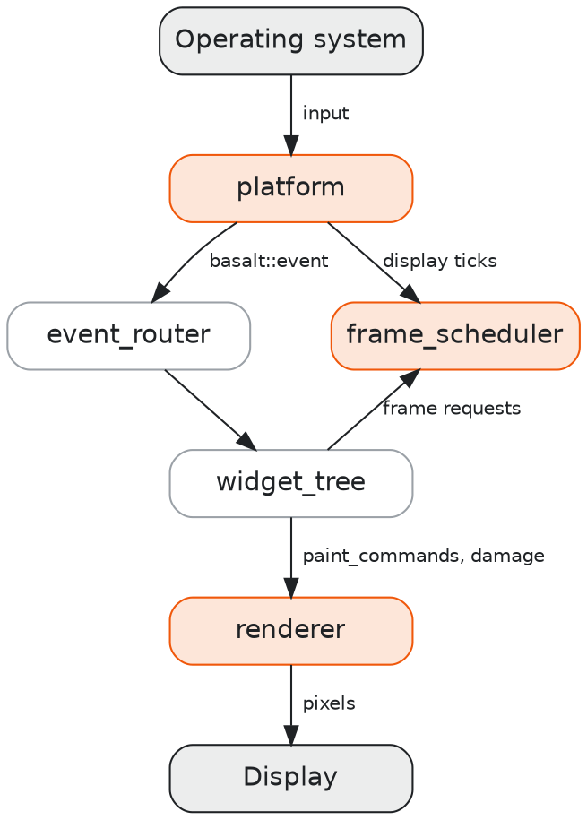
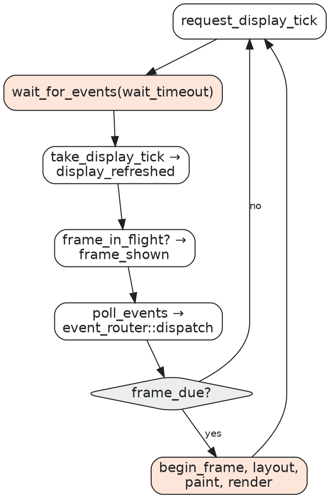

# Architecture

Magma has three parts: the platform, the frame scheduler, and the renderer. Your application owns
the event loop and connects the parts to a Basalt widget tree. This chapter describes each part and
the order in which they run.

## Parts and data flow

The platform reads input. Basalt changes the widget tree and records paint commands. The renderer
draws the commands. The frame scheduler decides when to start each frame. In the diagram, the
orange parts are Magma and the gray parts are Basalt.

Your application does these jobs:

1. It creates the platform, a window, and a renderer for the window.
2. It gives each event from the platform to Basalt.
3. It tells the scheduler about display refreshes, input, and frame requests.
4. When the scheduler says that a frame is due, it runs Basalt's frame cycle.
5. It gives the paint commands and the damaged areas to the renderer.

## Coordinates

Magma uses two units. A *layout pixel* is a window coordinate before the display scale. A *device
pixel* is one pixel of the screen.

Events, window sizes, paint commands, and damage are in layout pixels. These are the same units
that Basalt uses. The renderer multiplies by the display scale to get device pixels.
`platform::pixel_size` and `renderer::pixel_size` give sizes in device pixels.

## Platform

A `platform` owns the windows of the process. Create one platform for each process. Use it only on
the main thread. The one exception is `wake`, which you can call from any thread.

Each window has a `window_id`. Each event from `poll_events` is a `platform_event`. It holds the
window ID and a `basalt::event`. A quit request for the whole application uses window 0.

The platform also gives *display ticks*. A display tick tells when the display refreshed and when
it will refresh again. The frame scheduler uses ticks to start frames at the display's refreshes.

See [Platform](platform.md) for the details.

## Frame scheduler

A `frame_scheduler` decides when the next frame can start. It has no clock. You give it the time
on each call. Thus the same rules apply in an event loop and in a test.

The scheduler starts at most one frame for each display refresh. It starts a frame for input at
once when the previous frame is on the screen. This keeps the time from a key press to the screen
short.

See [Frame Scheduling](frame-scheduling.md) for the rules.

## Renderer

A `renderer` draws `basalt::paint_commands` into one window, or into memory. It keeps the last
frame. On each frame, it draws only the damaged areas and keeps the remaining pixels.

The renderer has four backends: `raster` on the CPU, and `metal`, `vulkan`, and `d3d12` on the
GPU. All backends give the same image within a small tolerance. The raster backend is the
reference.

See [Rendering](rendering.md) for the backends and their settings.

## Event loop

The event loop belongs to your application. Each pass through the loop does these steps:

1. While a frame is pending, call `platform::request_display_tick`.
2. Call `platform::wait_for_events` with the timeout from `frame_scheduler::wait_timeout`.
3. Give each tick from `take_display_tick` to `frame_scheduler::display_refreshed`.
4. When `renderer::frame_in_flight` is false, call `frame_scheduler::frame_shown`.
5. Call `poll_events` and give each event to Basalt. For input, call `request_input_frame`.
6. When `frame_due` is true, call `begin_frame`, run Basalt's frame cycle, and call
   `renderer::render`.

The wait ends at a display tick, at an event, at a call to `wake`, or at the timeout. Thus an idle
application uses no processor time.

## Threads

Magma is not thread-safe. Call the platform, the scheduler, and the renderer from the main thread.
To end a wait from another thread, call `platform::wake`. Then the loop runs, and your code on the
main thread reads the result of the other thread.

The raster backend draws large areas on up to four threads. Blend2D manages these threads. The
drawing is complete when `render` returns.

## Errors

Functions that can fail return `std::expected`. The error types are `platform_error` and
`render_error`. Each has a `message` that describes the problem.

A failed `render` can be temporary. For example, the window can be hidden or in a resize. Mark the
tree for repaint and try again on the next frame. Do not stop the program for one failed frame.
