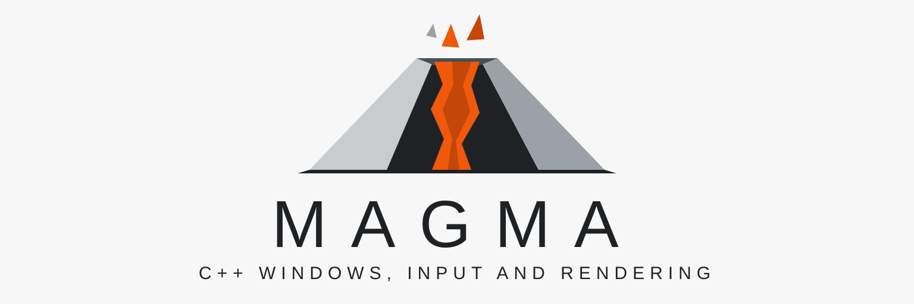

# Overview

Magma is a C++23 library. It gives [Basalt](https://github.com/nadiasvertex/basalt) applications
their windows, their input, and their pixels. Basalt turns a widget tree into paint commands.
Magma opens the windows, reads the input, decides when each frame starts, and draws the paint
commands.

This guide has these parts. This overview describes what Magma does. The architecture chapter
describes how the parts fit together. The getting-started chapter shows a first program. The
platform, frame scheduling, and rendering chapters describe each part in detail. The last chapter
records benchmark results.

## Who this guide is for

This guide is for C++ programmers. You must know C++20 or later and CMake. You must also know the
Basalt widget tree and its frame cycle. Read the Basalt guide first if Basalt is new to you. You do
not need to know SDL, Blend2D, Metal, Vulkan, or Direct3D.

## What Magma does

Magma does these tasks:

- It creates windows and reports their size, display scale, and refresh rate.
- It translates operating system input into `basalt::event` values.
- It supplies the clipboard, cursors, file dialogs, and text input for input methods.
- It decides when the next frame can start, from the display's refresh and from input.
- It draws Basalt paint commands on the GPU or on the CPU, and shows them in the window.
- It redraws only the damaged areas of each frame.

## What Magma does not do

Magma does not do these tasks. Your application does them.

- It does not own the event loop. Your application calls Magma from its own loop.
- It does not keep a widget tree. Your application gives events to Basalt and paint commands to
  Magma.
- It does not build an accessibility bridge.
- It does not load fonts. Basalt's `font_manager` loads them.

Magma uses Basalt's types in its API and does not wrap them. A `basalt::event` from Magma goes
directly to `basalt::event_router::dispatch`. A `basalt::paint_commands` value from Basalt goes
directly to `magma::renderer::render`.

## Parts

The library has three parts.

| Part | Header | Contents |
| ---- | ------ | -------- |
| Platform | `magma/platform.h` | Windows, input events, clipboard, cursors, file dialogs, text input, display ticks |
| Frame scheduler | `magma/frame_scheduler.h` | The rules that decide when the next frame starts |
| Renderer | `magma/renderer.h` | Draws paint commands into a window or into memory |

The header `magma/magma.h` includes every public header.

## Dependencies

Magma uses SDL 3 for the platform and Blend2D for drawing on the CPU. Both are private
dependencies. No public header includes them, and your application does not call them. The
graphics APIs are private dependencies too.

Basalt is a public dependency. When you link `magma::magma`, you also get `basalt::basalt`.

## Requirements

Magma needs CMake 3.25 or later. It needs a C++23 compiler and standard library. The `README.md`
file lists the tested compilers, the build options, and the release archives.

## Next steps

- Read [Architecture](architecture.md) to learn the parts and the event loop.
- Read [Getting Started](getting-started.md) to build a window with Basalt widgets.
- Read the headers in `include/magma/`. Each class has a comment that states its rules.
- Read `examples/event_loop.cpp` and `examples/hello_window.cpp` for complete programs.
